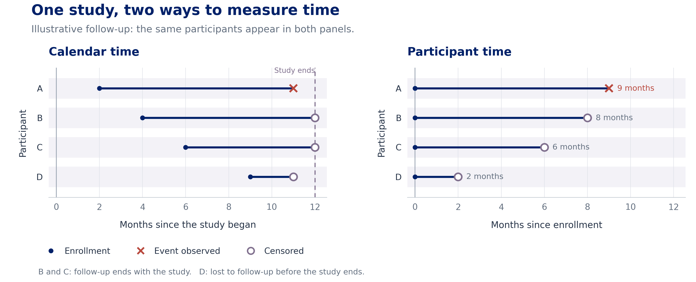
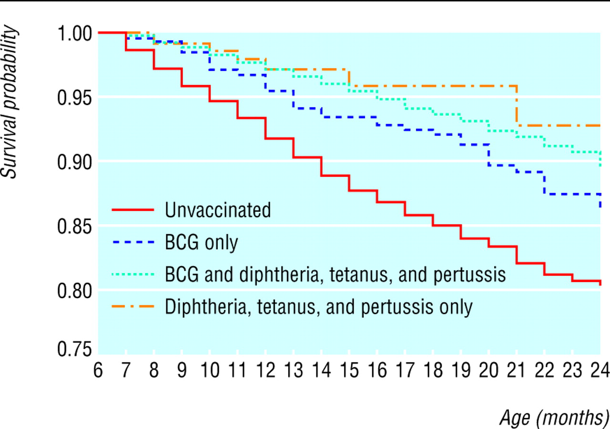
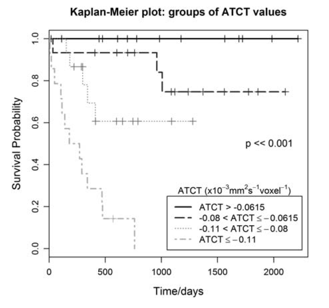

```{r, child="setup.Rmd", echo=FALSE}
```


```{r}
#| label: packages
#| include: false
library(survival)
library(ggsurvfit)
library(ggplot2)
library(dplyr)
library(readxl)
library(broom)
library(knitr)
set.seed(99999)
```


# Survival Data {#slide-01}


## Goal {#slide-02}


Survival analysis is a complex topic!  The goal of our coverage is to give you the skills you need to understand results of simple descriptive statistics in this setting, and we will not have time to discuss more complex modeling of survival data in this course. Come see me in the future if you need to analyze survival data!


## Examples {#slide-03}

<div style="font-size:0.8em;">

In many studies, the outcome of interest is the amount of time from an initial observation until the occurrence of some event of interest, e.g.

- Time from transplant surgery until new organ failure
- Time to death 
- Time to weaning
- Time to menarche
- Time to divorce
- Time to graduation

Typically, the event of interest is called a *failure* (even if it is a good thing).   The time interval between a starting point and the failure is known as the *survival time* and is often represented by $t$.

</div>

## Characteristics of Survival Data {#slide-04}

<div style="font-size:0.75em;">

Certain aspects of survival data make data analysis particularly challenging. 

- Typically, not all the individuals are observed until their times of failure
    - An organ transplant recipient may die in an automobile accident before the new organ fails
    - A student may withdraw to start a multi-billion dollar health company
    - Not everyone gets divorced
    - A pancreatic cancer patient may move to Aitutaki instead of undergoing further treatment
- In this case, an observation is said to be *right censored* at the last point of contact
  
  
When you hear someone talk about *censoring*, typically they mean *right censoring*, but there are other types of censoring that you may encounter.

</div>

## Censoring {#slide-05}

<div style="font-size:0.75em;">

Data may be censored in multiple ways:

- Right censored: the usual type of censoring in health data, accommodated by standard models. In this case you see a study participant at the beginning of the study, but you may not follow them until the outcome occurs (or the outcome may never occur)
  
- Left censored: a study participant may have experienced the event before the study begins. For example, you may want to study when kindergarteners reach a certain reading level, but some may be proficient readers already at the start of your study.
  
- Interval censored: you don't know exactly when an event happened, only that it happened between two times. For example, if a patient enrolled in a cancer screening study is cancer-free at the time of the first screening, $t_1$ but has cancer at the time of the second screening, $t_2$, you only know that cancer developed sometime after $t_1$ but before $t_2$

</div>

## Calendar Time and Participant Time {#slide-06}

<div style="font-size:0.9em;">


It is important to distinguish between calendar time and participant time. In the redrawn plot, a filled circle marks enrollment, an "X" marks an observed event, and an open circle marks censoring.

{width="88%" fig-align="center"}

</div>

## Calendar Time and Participant Time {#slide-07}

<div style="font-size:0.7em;">

{width="70%" fig-align="center"}

- A study may start enrolling patients in September and continue until all 500 patients have been enrolled
- This is likely to take months or years
- Time is typically converted from calendar time to participant time (time between enrollment and failure or censoring) before analysis

</div>

## The Survival Function {#slide-08}

<div style="font-size:0.9em;">

The distribution of survival times is characterized by the *survival function*, represented by $S(t)$.  For a continuous random variable $T$, $$S(t)=Pr(T>t)$$ and $S(t)$ represents the proportion of individuals who have not yet failed.  


The graph of $S(t)$ versus $t$ is called a survival curve.  The survival curve shows the proportion of survivors at any given time.

</div>

## Survival of Children in Burkina Faso by Vaccination Status  {#slide-09}

<div style="font-size:0.7em;">

{height="480px" fig-align="center"}

</div>

# Estimating Survival Curves {#slide-10}


## Small Study of 10 Patients {#slide-11}

<div style="font-size:0.7em;">

:::::: {.columns}

::::: {.column width="50%"}

| Patient | Event time $x$ | Event type |
|------:|-------:|---------:|
| 1 | 4.5 | Death |
| 2 | 7.5 | Death |
| 3 | 8.5 | Censored | 
| 4 | 11.5 | Death |
| 5 | 13.5 | Censored | 
| 6 | 15.5 | Death |
| 7 | 16.5 | Death |
| 8 | 17.5 | Censored | 
| 9 | 19.5 | Death |
| 10 | 21.5 | Censored |

:::::


::::: {.column width="50%"}

How do we estimate the survival curve for these data?

:::::

::::::

</div>

## Kaplan-Meier Estimate {#slide-12}

<div style="font-size:0.7em;">

Perhaps the most popular estimate of a survival curve is the *Kaplan-Meier* or *product-limit* estimate.  This method is actually fairly intuitive. Define the following quantities.

- $I_t$:  \# at risk of failure at time $t$; those who did not fail before $t$ and those who were not censored before $t$; also known as the *risk set*
- $d_t$:  \# who fail at time $t$
- $q_t=\frac{d_t}{I_t}$:  estimated probability of failing at time $t$
- $S(t)$:  cumulative probability of surviving beyond time $t$, estimated as 
$$\hat{S}(t)=\prod_{t_i \leq t} \left(1-\frac{d_{t_i}}{I_{t_i}}\right).$$

- the $\prod$ symbol is for multiplication, e.g. $\prod_{i=1}^3 x_i=x_1x_2x_3$ and $\prod_{i=1}^5i=1 \times 2 \times 3 \times 4 \times 5$.

</div>

## Intuitive how? {#slide-13}

<div style="font-size:0.75em;">

$$\hat{S}(t)=\prod_{t_i \leq t} \left(1-\frac{d_{t_i}}{I_{t_i}}\right)$$

At each time $t$, the probability of surviving is just $1-Pr(failing)$ (remember the complement rule, also known as the law of total probability!).  Before there are any failures in the data, our estimated $\hat{S}(t)=1$.  At the time of the first failure, this probability falls below 1 and is simply one minus the probability of failing at that time, or $1-\frac{\# ~ failures}{\#~at ~ risk~ of~ failing}$.

After the first failure, things get more complicated.  At the time of the second failure, you can calculate $1-\frac{\# ~ failures}{\# ~ at ~risk ~  of ~ failing}$, but this doesn't provide the whole picture, as someone else has already died.  In fact, this is the *conditional probability* of surviving now that you've made it past the time of the first failure.

</div>

## Welcome Back, Probability! {#slide-14}


I promised you'd see probability laws again!  :)

Coming back to you next:  the multiplicative rule!


## Multiplicative Rule Saves the Day! {#slide-15}

<div style="font-size:0.7em;">

$$\hat{S}(t)=\prod_{t_i \leq t} \left(1-\frac{d_{t_i}}{I_{t_i}}\right)$$

How do you then calculate the total (unconditional) probability of survival?  That is just the product of the probability of surviving past the first failure times the conditional probability of surviving beyond the second failure given that you made it past the first, or 

:::: {style="font-size:0.8em;"}

$$Pr(\text{survive past first and second times}) $$
$$=Pr(\text{survive past first time})Pr(\text{survive past second time} \mid \text{survive past first time})$$
$$=\left(1-\frac{\# ~ failures ~at ~failure~ time~ 1}{\# ~at~ risk ~of ~failing ~at ~failure ~time ~1}\right)\left(1-\frac{\# ~of ~ failures ~ at ~ failure ~ time~  2}{\# ~ at ~ risk ~ of ~ failing ~ at ~ failure~  time~ 2}\right)$$

::::


If someone is censored, they leave the observed *risk set* at that time and are excluded from later risk-set denominators. Their event may still occur after follow-up ends.

</div>

## Kaplan-Meier (KM) Estimate {.km-slide #slide-16}

<div style="font-size:0.6em;">

:::::: {.columns}

::::: {.column width="58%"}


| $t$ | # Failed: $d_t$ | # Censored | # Left: $I_{t+1}$ | $\hat{S}(t)$ |
|------:|-------:|---------:|------:|------:|
| 0.0 | 0 | 0 | | |
| 4.5 | 1 | 0 | | |
| 7.5 | 1 | 0 | | |
| 8.5 | 0 | 1 | | |
| 11.5 | 1 | 0 | | |
| 13.5 | 0 | 1 | | |
| 15.5 | 1 | 0 | | |
| 16.5 | 1 | 0 | | |
| 17.5 | 0 | 1 | | |
| 19.5 | 1 | 0 | | |
| 21.5 | 0 | 1 | | |

:::::


::::: {.column width="42%"}

$$\hat{S}(t)=\prod_{t_i \leq t} \left(1-\frac{d_{t_i}}{I_{t_i}}\right)$$
Remember $d_t$ is the # who fail at time $t$, and $I_t$ is the # at risk of failure at time $t$ (have not been censored and have not failed)


:::::

::::::

</div>

## Kaplan-Meier Estimate: Time 0 {.km-slide #slide-17}

<div style="font-size:0.6em;">

:::::: {.columns}

::::: {.column width="58%"}


| $t$ | # Failed: $d_t$ | # Censored | # Left: $I_{t+1}$ | $\hat{S}(t)$ |
|------:|-------:|---------:|------:|------:|
| 0.0 | 0 | 0 | [10]{.km-current} | [1]{.km-current} |
| 4.5 | 1 | 0 | | |
| 7.5 | 1 | 0 | | |
| 8.5 | 0 | 1 | | |
| 11.5 | 1 | 0 | | |
| 13.5 | 0 | 1 | | |
| 15.5 | 1 | 0 | | |
| 16.5 | 1 | 0 | | |
| 17.5 | 0 | 1 | | |
| 19.5 | 1 | 0 | | |
| 21.5 | 0 | 1 | | |

:::::


::::: {.column width="42%"}


$$\hat{S}(t)=\prod_{t_i \leq t} \left(1-\frac{d_{t_i}}{I_{t_i}}\right)$$

$\hat{S}(0)=1$


:::::

::::::

</div>

## Kaplan-Meier Estimate: Time 4.5 {.km-slide #slide-18}

<div style="font-size:0.6em;">

:::::: {.columns}

::::: {.column width="58%"}


| $t$ | # Failed: $d_t$ | # Censored | # Left: $I_{t+1}$ | $\hat{S}(t)$ |
|------:|-------:|---------:|------:|------:|
| 0.0 | 0 | 0 | 10 | 1 |
| 4.5 | 1 | 0 |  [9]{.km-current} | [$1 \times \left(1-\frac{1}{10}\right)=0.9$]{.km-current} |
| 7.5 | 1 | 0 | | |
| 8.5 | 0 | 1 | | |
| 11.5 | 1 | 0 | | |
| 13.5 | 0 | 1 | | |
| 15.5 | 1 | 0 | | |
| 16.5 | 1 | 0 | | |
| 17.5 | 0 | 1 | | |
| 19.5 | 1 | 0 | | |
| 21.5 | 0 | 1 | | |

:::::


::::: {.column width="42%"}


$$\hat{S}(t)=\prod_{t_i \leq t} \left(1-\frac{d_{t_i}}{I_{t_i}}\right)$$


$$Pr(\text{survive past time 4.5}) $$
$$=Pr(\text{survive past time 0}) $$
$$\times Pr(\text{survive past time 4.5} \mid \text{survive past time 0})$$

:::::

::::::

</div>

## Kaplan-Meier Estimate: Time 7.5 {.km-slide #slide-19}

<div style="font-size:0.6em;">

:::::: {.columns}

::::: {.column width="58%"}


| $t$ | # Failed: $d_t$ | # Censored | # Left: $I_{t+1}$ | $\hat{S}(t)$ |
|------:|-------:|---------:|------:|------:|
| 0.0 | 0 | 0 | 10 | 1 |
| 4.5 | 1 | 0 | 9 | 0.9 |
| 7.5 | 1 | 0 |  [8]{.km-current} | [$0.9 \times \left(1-\frac{1}{9}\right)=0.8$]{.km-current} |
| 8.5 | 0 | 1 | | |
| 11.5 | 1 | 0 | | |
| 13.5 | 0 | 1 | | |
| 15.5 | 1 | 0 | | |
| 16.5 | 1 | 0 | | |
| 17.5 | 0 | 1 | | |
| 19.5 | 1 | 0 | | |
| 21.5 | 0 | 1 | | |

:::::


::::: {.column width="42%"}


$$\hat{S}(t)=\prod_{t_i \leq t} \left(1-\frac{d_{t_i}}{I_{t_i}}\right)$$

$$Pr(\text{survive past time 7.5}) $$
$$=Pr(\text{survive past time 4.5})$$
$$\times Pr(\text{survive past time 7.5} \mid \text{survive past time 4.5})$$

:::::

::::::

</div>

## Kaplan-Meier Estimate: Time 8.5 {.km-slide #slide-20}

<div style="font-size:0.6em;">

:::::: {.columns}

::::: {.column width="58%"}


| $t$ | # Failed: $d_t$ | # Censored | # Left: $I_{t+1}$ | $\hat{S}(t)$ |
|------:|-------:|---------:|------:|------:|
| 0.0 | 0 | 0 | 10 | 1 |
| 4.5 | 1 | 0 | 9 | 0.9 |
| 7.5 | 1 | 0 |  8 | 0.8 |
| 8.5 | 0 | 1 | [7]{.km-current} | [$0.8 \times \left(1-\frac{0}{8}\right)=0.8$]{.km-current} |
| 11.5 | 1 | 0 | | |
| 13.5 | 0 | 1 | | |
| 15.5 | 1 | 0 | | |
| 16.5 | 1 | 0 | | |
| 17.5 | 0 | 1 | | |
| 19.5 | 1 | 0 | | |
| 21.5 | 0 | 1 | | |

:::::


::::: {.column width="42%"}


$$\hat{S}(t)=\prod_{t_i \leq t} \left(1-\frac{d_{t_i}}{I_{t_i}}\right)$$


$$Pr(\text{survive past time 8.5}) $$
$$=Pr(\text{survive past time 7.5})$$
$$\times Pr(\text{survive past time 8.5} \mid \text{survive past time 7.5})$$


:::::

::::::

</div>

## Kaplan-Meier Estimate: Time 11.5 {.km-slide #slide-21}

<div style="font-size:0.6em;">

:::::: {.columns}

::::: {.column width="58%"}


| $t$ | # Failed: $d_t$ | # Censored | # Left: $I_{t+1}$ | $\hat{S}(t)$ |
|------:|-------:|---------:|------:|------:|
| 0.0 | 0 | 0 | 10 | 1 |
| 4.5 | 1 | 0 | 9 | 0.9 |
| 7.5 | 1 | 0 |  8 | 0.8 |
| 8.5 | 0 | 1 | 7 | 0.8 |
| 11.5 | 1 | 0 | [6]{.km-current} | [$0.8 \times \left(1-\frac{1}{7}\right)=0.69$]{.km-current} |
| 13.5 | 0 | 1 | | |
| 15.5 | 1 | 0 | | |
| 16.5 | 1 | 0 | | |
| 17.5 | 0 | 1 | | |
| 19.5 | 1 | 0 | | |
| 21.5 | 0 | 1 | | |

:::::


::::: {.column width="42%"}

$$\hat{S}(t)=\prod_{t_i \leq t} \left(1-\frac{d_{t_i}}{I_{t_i}}\right)$$


$$Pr(\text{survive past time 11.5}) $$
$$=Pr(\text{survive past time 8.5})$$
$$\times Pr(\text{survive past time 11.5} \mid \text{survive past time 8.5})$$


:::::

::::::

</div>

## Kaplan-Meier Estimate: Time 13.5 {.km-slide #slide-22}

<div style="font-size:0.6em;">


:::::: {.columns}

::::: {.column width="58%"}


| $t$ | # Failed: $d_t$ | # Censored | # Left: $I_{t+1}$ | $\hat{S}(t)$ |
|------:|-------:|---------:|------:|------:|
| 0.0 | 0 | 0 | 10 | 1 |
| 4.5 | 1 | 0 | 9 | 0.9 |
| 7.5 | 1 | 0 |  8 | 0.8 |
| 8.5 | 0 | 1 | 7 | 0.8 |
| 11.5 | 1 | 0 | 6 | 0.69 |
| 13.5 | 0 | 1 | 5 | [$0.69 \times \left(1-\frac{0}{6}\right)=0.69$]{.km-current} |
| 15.5 | 1 | 0 | | |
| 16.5 | 1 | 0 | | |
| 17.5 | 0 | 1 | | |
| 19.5 | 1 | 0 | | |
| 21.5 | 0 | 1 | | |

:::::


::::: {.column width="42%"}


$$\hat{S}(t)=\prod_{t_i \leq t} \left(1-\frac{d_{t_i}}{I_{t_i}}\right)$$

$$Pr(\text{survive past time 13.5}) $$
$$=Pr(\text{survive past time 11.5})$$
$$\times Pr(\text{survive past time 13.5} \mid \text{survive past time 11.5})$$


:::::

::::::

</div>

## Kaplan-Meier Estimate: Time 15.5 {.km-slide #slide-23}

<div style="font-size:0.6em;">

:::::: {.columns}

::::: {.column width="58%"}


| $t$ | # Failed: $d_t$ | # Censored | # Left: $I_{t+1}$ | $\hat{S}(t)$ |
|------:|-------:|---------:|------:|------:|
| 0.0 | 0 | 0 | 10 | 1 |
| 4.5 | 1 | 0 | 9 | 0.9 |
| 7.5 | 1 | 0 |  8 | 0.8 |
| 8.5 | 0 | 1 | 7 | 0.8 |
| 11.5 | 1 | 0 | 6 | 0.69 |
| 13.5 | 0 | 1 | 5 | 0.69 |
| 15.5 | 1 | 0 | [4]{.km-current} | [$0.69 \times \left(1-\frac{1}{5}\right)=0.552$]{.km-current} |
| 16.5 | 1 | 0 | | |
| 17.5 | 0 | 1 | | |
| 19.5 | 1 | 0 | | |
| 21.5 | 0 | 1 | | |

:::::


::::: {.column width="42%"}


$$\hat{S}(t)=\prod_{t_i \leq t} \left(1-\frac{d_{t_i}}{I_{t_i}}\right)$$

$$Pr(\text{survive past time 15.5}) $$
$$=Pr(\text{survive past time 13.5})$$
$$\times Pr(\text{survive past time 15.5} \mid \text{survive past time 13.5})$$


:::::

::::::

</div>

## Kaplan-Meier Estimate: Time 16.5 {.km-slide #slide-24}

<div style="font-size:0.6em;">

:::::: {.columns}

::::: {.column width="58%"}


| $t$ | # Failed: $d_t$ | # Censored | # Left: $I_{t+1}$ | $\hat{S}(t)$ |
|------:|-------:|---------:|------:|------:|
| 0.0 | 0 | 0 | 10 | 1 |
| 4.5 | 1 | 0 | 9 | 0.9 |
| 7.5 | 1 | 0 |  8 | 0.8 |
| 8.5 | 0 | 1 | 7 | 0.8 |
| 11.5 | 1 | 0 | 6 | 0.69 |
| 13.5 | 0 | 1 | 5 | 0.69 |
| 15.5 | 1 | 0 | 4 | 0.552 |
| 16.5 | 1 | 0 | [3]{.km-current} | [$0.552 \times \left(1-\frac{1}{4}\right)=0.414$]{.km-current} |
| 17.5 | 0 | 1 | | |
| 19.5 | 1 | 0 | | |
| 21.5 | 0 | 1 | | |

:::::


::::: {.column width="42%"}


$$\hat{S}(t)=\prod_{t_i \leq t} \left(1-\frac{d_{t_i}}{I_{t_i}}\right)$$


$$Pr(\text{survive past time 16.5}) $$
$$=Pr(\text{survive past time 15.5})$$
$$\times Pr(\text{survive past time 16.5} \mid \text{survive past time 15.5})$$


:::::

::::::

</div>

## Kaplan-Meier Estimate: Time 17.5 {.km-slide #slide-25}

<div style="font-size:0.6em;">

:::::: {.columns}

::::: {.column width="58%"}


| $t$ | # Failed: $d_t$ | # Censored | # Left: $I_{t+1}$ | $\hat{S}(t)$ |
|------:|-------:|---------:|------:|------:|
| 0.0 | 0 | 0 | 10 | 1 |
| 4.5 | 1 | 0 | 9 | 0.9 |
| 7.5 | 1 | 0 |  8 | 0.8 |
| 8.5 | 0 | 1 | 7 | 0.8 |
| 11.5 | 1 | 0 | 6 | 0.69 |
| 13.5 | 0 | 1 | 5 | 0.69 |
| 15.5 | 1 | 0 | 4 | 0.552 |
| 16.5 | 1 | 0 | 3 | 0.414 |
| 17.5 | 0 | 1 | [2]{.km-current} | [$0.414 \times \left(1-\frac{0}{3}\right)=0.414$]{.km-current} |
| 19.5 | 1 | 0 | | |
| 21.5 | 0 | 1 | | |

:::::


::::: {.column width="42%"}


$$\hat{S}(t)=\prod_{t_i \leq t} \left(1-\frac{d_{t_i}}{I_{t_i}}\right)$$


$$Pr(\text{survive past time 17.5}) $$
$$=Pr(\text{survive past time 16.5})$$
$$\times Pr(\text{survive past time 17.5} \mid \text{survive past time 16.5})$$


:::::

::::::

</div>

## Kaplan-Meier Estimate: Time 19.5 {.km-slide #slide-26}

<div style="font-size:0.6em;">

:::::: {.columns}

::::: {.column width="58%"}


| $t$ | # Failed: $d_t$ | # Censored | # Left: $I_{t+1}$ | $\hat{S}(t)$ |
|------:|-------:|---------:|------:|------:|
| 0.0 | 0 | 0 | 10 | 1 |
| 4.5 | 1 | 0 | 9 | 0.9 |
| 7.5 | 1 | 0 |  8 | 0.8 |
| 8.5 | 0 | 1 | 7 | 0.8 |
| 11.5 | 1 | 0 | 6 | 0.69 |
| 13.5 | 0 | 1 | 5 | 0.69 |
| 15.5 | 1 | 0 | 4 | 0.552 |
| 16.5 | 1 | 0 | 3 | 0.414 |
| 17.5 | 0 | 1 | 2 | 0.414 |
| 19.5 | 1 | 0 | [1]{.km-current} | [$0.414 \times \left(1-\frac{1}{2}\right)=0.207$]{.km-current} |
| 21.5 | 0 | 1 | | |

:::::


::::: {.column width="42%"}


$$\hat{S}(t)=\prod_{t_i \leq t} \left(1-\frac{d_{t_i}}{I_{t_i}}\right)$$

$$Pr(\text{survive past time 19.5}) $$
$$=Pr(\text{survive past time 17.5})$$
$$\times Pr(\text{survive past time 19.5} \mid \text{survive past time 17.5})$$


:::::

::::::

</div>

## Kaplan-Meier Estimate: Time 21.5 {.km-slide #slide-27}

<div style="font-size:0.6em;">


:::::: {.columns}

::::: {.column width="58%"}


| $t$ | # Failed: $d_t$ | # Censored | # Left: $I_{t+1}$ | $\hat{S}(t)$ |
|------:|-------:|---------:|------:|------:|
| 0.0 | 0 | 0 | 10 | 1 |
| 4.5 | 1 | 0 | 9 | 0.9 |
| 7.5 | 1 | 0 |  8 | 0.8 |
| 8.5 | 0 | 1 | 7 | 0.8 |
| 11.5 | 1 | 0 | 6 | 0.69 |
| 13.5 | 0 | 1 | 5 | 0.69 |
| 15.5 | 1 | 0 | 4 | 0.552 |
| 16.5 | 1 | 0 | 3 | 0.414 |
| 17.5 | 0 | 1 | 2 | 0.414 |
| 19.5 | 1 | 0 | 1 | 0.207 |
| 21.5 | 0 | 1 | 0 | [$0.207 \times \left(1-\frac{0}{1}\right)=0.207$]{.km-current} |

:::::


::::: {.column width="42%"}


$$\hat{S}(t)=\prod_{t_i \leq t} \left(1-\frac{d_{t_i}}{I_{t_i}}\right)$$


$$Pr(\text{survive past time 21.5}) $$
$$=Pr(\text{survive past time 19.5})$$
$$\times Pr(\text{survive past time 21.5} \mid \text{survive past time 19.5})$$


:::::

::::::

</div>

## KM Estimate {#slide-28}


In between failure times, the KM estimate does not change but is constant.  This gives the estimated survival function its step-like appearance (we call this type of function a *step function*).


## Tumors in Children, 2012 *Neuro-Oncology* {#slide-29}

<div style="font-size:0.6em;">


:::::: {.columns}

::::: {.column width="50%"}

ATCT is an imaging-based biomarker of tumor prognosis.

{width="96%" fig-align="center"}

:::::

::::: {.column width="50%"}

- Which biomarker values are associated with the best survival?
- Which values are associated with the worst survival?
- What is the median survival time in the group with the smallest ATCT values?
    - Median survival is the first time at which $\hat{S}(t)\leq 0.5$
- If a child is in the group with the largest ATCT values, what is their estimated 5-year survival probability?

:::::

::::::

</div>

## Weaning in Wild Chimpanzees {#slide-30}

<div style="font-size:0.6em;">

::: {.panel-tabset}

### Data

```{r}
#| label: read-weaning-data
#| echo: false
weaning <- read_excel(
  "../data/weaning_lonsdorf.xlsx",
  sheet = "Data",
  na = c("", "NA", "na")
) %>%
  select(id, momid, weanedage_yrs, weaned, B_Sex, B_FirstBorn) %>%
  mutate(
    B_Sex = factor(B_Sex, levels = c("F", "M"),
                   labels = c("Female", "Male")),
    B_FirstBorn = factor(B_FirstBorn, levels = c("N", "Y"),
                        labels = c("No", "Yes"))
  )
```

These data describe **wild chimpanzees in Tanzania** and are provided courtesy of Prof. Elizabeth Lonsdorf at Duke Lemur Center. We study the age at which offspring are weaned.

| Variable | Meaning |
|:--|:--|
| `weanedage_yrs` | Age in years at weaning or censoring  |
| `weaned` | Event indicator: **1 = weaned**, **0 = censored**  |
| `B_Sex` | Offspring sex: F = female, M = male |
| `B_FirstBorn` | Firstborn status: Y = yes, N = no  |

There are **`r nrow(weaning)` chimpanzees**, with **`r sum(weaning$weaned == 1)` observed weaning events** and **`r sum(weaning$weaned == 0)` censored observations**.

The event is **weaning**. Here, $S(t)=P(T>t)$ is the probability of **not yet being weaned at age $t$**.

### Code

```r
weaning <- read_excel(
  "../data/weaning_lonsdorf.xlsx",
  sheet = "Data",
  na = c("", "NA", "na")
) %>%
  select(id, momid, weanedage_yrs, weaned, B_Sex, B_FirstBorn) %>%
  mutate(
    B_Sex = factor(B_Sex, levels = c("F", "M"),
                   labels = c("Female", "Male")),
    B_FirstBorn = factor(B_FirstBorn, levels = c("N", "Y"),
                        labels = c("No", "Yes"))
  )
```

:::

</div>

::: {.notes}
Use column K exactly as supplied. Checking the source dates shows that recorded event ages use the midpoint between last nursing and the next follow-up, while censored ages use the last recorded nursing date. This classroom analysis treats recorded event ages as exact and uses right censoring. The observation intervals and reasons for censoring deserve closer attention in a full research analysis.
:::

## Weaning by Sex {#slide-31}

<div style="font-size:0.7em;">

::: {.panel-tabset}

### Plot

```{r}
#| label: surv-plot
#| echo: false
#| fig-width: 9
#| fig-height: 4.2
#| out-width: "82%"
weaning_sex_fit <- survfit2(
  Surv(weanedage_yrs, weaned) ~ B_Sex,
  data = weaning
)

ggsurvfit(weaning_sex_fit) +
  add_censor_mark() +
  scale_color_manual(values = c("Female" = "#B9AEC8", "Male" = "#012169")) +
  labs(
    x = "Age (years)", y = "Probability not yet weaned",
    color = "Sex"
  ) +
  theme_minimal(base_size = 16) +
  theme(legend.position = "bottom")
```

A higher curve means a larger estimated probability of **still being unweaned** at a given age. The marks show censored observations.

### Code

```r
weaning_sex_fit <- survfit2(
  Surv(weanedage_yrs, weaned) ~ B_Sex,
  data = weaning
)

ggsurvfit(weaning_sex_fit) +
  add_censor_mark() +
  scale_color_manual(values = c("Female" = "#B9AEC8", "Male" = "#012169")) +
  labs(
    x = "Age (years)", y = "Probability not yet weaned",
    color = "Sex"
  ) +
  theme_minimal(base_size = 16) +
  theme(legend.position = "bottom")
```

:::

</div>

## Weaning by Firstborn Status {#weaning-firstborn}

<div style="font-size:0.7em;">

::: {.panel-tabset}

### Plot

```{r}
#| label: weaning-firstborn-plot
#| echo: false
#| fig-width: 9
#| fig-height: 4.2
#| out-width: "82%"
weaning_firstborn_fit <- survfit2(
  Surv(weanedage_yrs, weaned) ~ B_FirstBorn,
  data = weaning
)

ggsurvfit(weaning_firstborn_fit) +
  add_censor_mark() +
  scale_color_manual(values = c("No" = "#B9AEC8", "Yes" = "#012169")) +
  labs(
    x = "Age (years)", y = "Probability not yet weaned",
    color = "Firstborn?"
  ) +
  theme_minimal(base_size = 16) +
  theme(legend.position = "bottom")
```

At a given age, which group has the larger estimated probability of not yet being weaned? Does the pattern look the same across the age range?

### Code

```r
weaning_firstborn_fit <- survfit2(
  Surv(weanedage_yrs, weaned) ~ B_FirstBorn,
  data = weaning
)

ggsurvfit(weaning_firstborn_fit) +
  add_censor_mark() +
  scale_color_manual(values = c("No" = "#B9AEC8", "Yes" = "#012169")) +
  labs(
    x = "Age (years)", y = "Probability not yet weaned",
    color = "Firstborn?"
  ) +
  theme_minimal(base_size = 16) +
  theme(legend.position = "bottom")
```

:::

</div>

## Estimating Median Weaning Age {#slide-32}

<div style="font-size:0.7em;">

The **median weaning age** is the first age at which the estimated probability of not yet being weaned is at most 0.5.

::: {.panel-tabset}

### Results

```{r}
#| label: medsurv
#| echo: false
sex_medians <- summary(weaning_sex_fit)$table
firstborn_medians <- summary(weaning_firstborn_fit)$table

median_weaning <- data.frame(
  Comparison = rep(c("Sex", "Firstborn?"), each = 2),
  Group = c(levels(weaning$B_Sex), levels(weaning$B_FirstBorn)),
  Median = c(sex_medians[, "median"], firstborn_medians[, "median"])
)

knitr::kable(
  median_weaning, digits = 2, row.names = FALSE,
  col.names = c("Comparison", "Group", "Median age (years)")
)
```

Estimated median weaning ages are **`r round(sex_medians[1, "median"], 2)` years for females** and **`r round(sex_medians[2, "median"], 2)` years for males**.

### Code

```r
# Each fitted object reports the median and its confidence interval.
weaning_sex_fit
weaning_firstborn_fit
```

:::

If the curve never reaches 0.5, the median cannot be estimated from the available follow-up. Some confidence limits may also be unavailable.

</div>

## Comparing Weaning Across Groups {#slide-33}

<div style="font-size:0.6em;">

The **log-rank test** compares the time-to-weaning distributions between groups and is closely related to the $chi^2$ test we studied for contingency tables. We separately compare sexes and firstborn groups.

For each comparison, $H_0$ is that the groups have the same survival function. The alternative is that the survival functions differ.

::: {.panel-tabset}

### Results

```{r}
#| label: logrank
#| echo: false
weaning_logrank_sex <- survdiff(
  Surv(weanedage_yrs, weaned) ~ B_Sex,
  data = weaning, rho = 0
)
weaning_logrank_firstborn <- survdiff(
  Surv(weanedage_yrs, weaned) ~ B_FirstBorn,
  data = weaning, rho = 0
)

logrank_results <- data.frame(
  Comparison = c("Sex", "Firstborn status"),
  chisq = c(weaning_logrank_sex$chisq, weaning_logrank_firstborn$chisq)
) %>%
  mutate(p_value = pchisq(chisq, df = 1, lower.tail = FALSE))

knitr::kable(
  logrank_results, digits = 3, row.names = FALSE,
  col.names = c("Comparison", "Chi-square statistic", "p-value")
)
```

The p-values are **`r round(logrank_results$p_value[1], 3)` for sex** and **`r round(logrank_results$p_value[2], 3)` for firstborn status**.

`r if (all(logrank_results$p_value >= 0.05)) "Neither test provides strong evidence of different weaning distributions at the 5% significance level. This does not establish that the distributions are identical." else "Compare each p-value with the chosen significance level to assess the evidence of a difference in weaning distributions."`

### Code

```r
weaning_logrank_sex <- survdiff(
  Surv(weanedage_yrs, weaned) ~ B_Sex,
  data = weaning, rho = 0
)
weaning_logrank_firstborn <- survdiff(
  Surv(weanedage_yrs, weaned) ~ B_FirstBorn,
  data = weaning, rho = 0
)

weaning_logrank_sex
weaning_logrank_firstborn
```

:::

These simple log-rank tests treat offspring as independent. Some chimps share a mother; the Cox model on the next slide allows for this dependence when estimating uncertainty.

</div>

## Cox Proportional Hazards Model {#slide-34}

<div style="font-size:0.6em;">

We can use a **Cox proportional hazards model** to examine sex and firstborn status together.

- **Time scale:** age in years.
- **Event:** weaning.
- **Predictors:** `B_Sex` and `B_FirstBorn`.

The model compares the instantaneous rates, or hazards, of weaning among chimpanzees who have **not yet been weaned** at a given age, holding the other predictor constant.

Key assumptions include:

- **Non-informative censoring:** conditional on the predictors, censoring does not provide additional information about the unobserved weaning time.
- **Proportional hazards:** the hazard ratios are constant across age.

Some offspring share a mother. We use `cluster = momid` to allow for this dependence in the standard errors and confidence intervals.

</div>

## Cox Model for Weaning {#slide-35}

<div style="font-size:0.6em;">

::: {.panel-tabset}

### Results

```{r}
#| label: cox
#| echo: false
weaning_cox <- coxph(
  Surv(weanedage_yrs, weaned) ~ B_Sex + B_FirstBorn,
  data = weaning,
  cluster = momid
)

cox_results <- tidy(
  weaning_cox, exponentiate = TRUE, conf.int = TRUE
)

cox_results %>%
  mutate(
    term = recode(term,
      "B_SexMale" = "Male vs. female",
      "B_FirstBornYes" = "Firstborn vs. not firstborn"
    ),
    CI = sprintf("(%.2f,%.2f)", conf.low, conf.high)
  ) %>%
  select(term, estimate, CI, p.value) %>%
  knitr::kable(
    digits = c(0, 2, 0, 3),
    row.names = FALSE,
    col.names = c("Comparison", "Hazard ratio", "95% CI", "p-value")
  )
```

The reference groups are **female** and **not firstborn**. Each hazard ratio adjusts for the other predictor.

### Code

```r
cox_results %>%
  mutate(
    term = recode(term,
      "B_SexMale" = "Male vs. female",
      "B_FirstBornYes" = "Firstborn vs. not firstborn"
    ),
    CI = sprintf("(%.2f,%.2f)", conf.low, conf.high)
  ) %>%
  select(term, estimate, CI, p.value) %>%
  knitr::kable(
    digits = c(0, 2, 0, 3),
    row.names = FALSE,
    col.names = c("Comparison", "Hazard ratio", "95% CI", "p-value")
  )
```

:::

</div>

## Interpreting Hazard Ratios for Weaning {#slide-36}

<div style="font-size:0.7em;">

- **HR > 1:** a higher instantaneous rate of weaning among those not yet weaned.
- **HR < 1:** a lower instantaneous rate of weaning among those not yet weaned.

The estimated HR comparing **males with females** is **`r round(cox_results$estimate[cox_results$term == "B_SexMale"], 2)`**. At the same age and firstborn status, males have an estimated **`r round(cox_results$estimate[cox_results$term == "B_SexMale"], 2)` times the weaning hazard** of females.

The estimated HR comparing **firstborn with other offspring** is **`r round(cox_results$estimate[cox_results$term == "B_FirstBornYes"], 2)`**, conditional on sex.

A hazard ratio describes a ratio of instantaneous rates or hazards, not a ratio of median weaning ages. Consider the confidence intervals as well as the point estimates.

</div>

## Cystic Fibrosis and Inhaled rhDNase


```{r}
#| label: cf-case-setup
#| include: false


data("rhDNase", package = "survival")

# Prepare one observation per participant. The analysis population excludes
# participants with an IV-antibiotic episode starting on or before enrollment.
# This baseline restriction keeps the classroom example a right-censored
# analysis without delayed entry. Retain participants without any event.
cf_participants <- rhDNase %>%
  group_by(id) %>%
  summarise(
    trt = first(trt),
    followup = first(as.numeric(end.dt - entry.dt)),
    baseline_infection = any(ivstart <= 0, na.rm = TRUE),
    first_event = if (any(ivstart > 0, na.rm = TRUE)) {
      min(ivstart[!is.na(ivstart) & ivstart > 0])
    } else {
      NA_real_
    },
    .groups = "drop"
  )

cf_first <- cf_participants %>%
  filter(!baseline_infection, !is.na(followup), followup > 0) %>%
  mutate(
    followup = pmin(followup, 169),
    status = as.integer(!is.na(first_event) & first_event <= followup),
    time = pmin(first_event, followup, na.rm = TRUE),
    treatment = factor(trt, levels = c(0, 1),
                       labels = c("Placebo", "rhDNase"))
  ) %>%
  select(id, treatment, time, status)

stopifnot(
  nrow(cf_first) == n_distinct(cf_first$id),
  !anyNA(cf_first),
  all(cf_first$time > 0 & cf_first$time <= 169),
  all(cf_first$status %in% c(0L, 1L))
)

cf_km <- survfit2(Surv(time, status) ~ treatment, data = cf_first)
cf_logrank <- survdiff(Surv(time, status) ~ treatment, data = cf_first,
                      rho = 0)
cf_logrank_p <- pchisq(cf_logrank$chisq,
                      df = length(cf_logrank$n) - 1,
                      lower.tail = FALSE)

cf_cox <- coxph(Surv(time, status) ~ treatment, data = cf_first)
cf_cox_results <- tidy(cf_cox, exponentiate = TRUE, conf.int = TRUE)
cf_hr <- cf_cox_results$estimate[1]
cf_ci <- sprintf("(%.2f,%.2f)", cf_cox_results$conf.low[1],
                 cf_cox_results$conf.high[1])
cf_format_p <- function(p) {
  if (p < 0.001) "< 0.001" else sprintf("= %.3f", p)
}
```


<div style="font-size:0.7em;">

Cystic fibrosis can cause thick mucus to accumulate in the lungs, making it harder to clear infections.

**rhDNase** is an inhaled enzyme that breaks down extracellular DNA in mucus and helps make the mucus easier to clear.

Researchers conducted a **randomized, double-blind trial** comparing rhDNase with placebo.

::: {.question}

Does rhDNase help patients go longer without a pulmonary exacerbation requiring intravenous (IV) antibiotics?

:::

</div>

::: {.notes}
Source: survival package documentation for rhDNase:
https://stat.ethz.ch/R-manual/R-devel/library/survival/html/rhDNase.html
The trial dates to 1992. The endpoint is a pulmonary exacerbation requiring IV
antibiotics. These slides use the historical trial to teach survival analysis.
:::

## The Outcome and Censoring

<div style="font-size:0.65em;">

Our analysis includes participants without an exacerbation at enrollment and follows them for up to **169 days**. Each participant contributes **one observation**.

| Variable | Meaning |
|:--|:--|
| `treatment` | Placebo or rhDNase |
| `time` | Days from enrollment to the first exacerbation or censoring |
| `status = 1` | An exacerbation was observed |
| `status = 0` | Follow-up ended before an exacerbation was observed |

There are **`r nrow(cf_first)` participants**, with **`r sum(cf_first$status)` observed events** and **`r sum(cf_first$status == 0)` censored observations**.

Here, $S(t)=P(T>t)$ describes the probability of remaining **free of a first exacerbation** beyond day $t$.

</div>

::: {.notes}
Data and variable definitions:
https://stat.ethz.ch/R-manual/R-devel/library/survival/html/rhDNase.html
Additional source and preparation guidance:
https://www.mayo.edu/research/departments-divisions/quantitative-health-sciences/divisions/clinical-trials-biostatistics/research/survival-analysis/modeling-survival-data-extending-cox-model/datasets

The original data contain multiple rows for some patients. The hidden setup
chunk first groups by patient, finds the earliest positive IV-antibiotic start
time, and retains patients with no event as censored observations. It excludes
patients whose IV-antibiotic episode began on or before enrollment, along with
patients without positive follow-up. This is a baseline-defined classroom
subset of the randomized study. A complete trial analysis would retain patients
with a prevalent infection using the appropriate entry times.

All displayed sample sizes, estimates, confidence intervals, p-values, and
interpretations come from the prepared subset when R executes this file.
Published analyses can give different numerical estimates because of differences
in the data version, analysis population, or event definition.
:::

## Exacerbation-Free Survival Curves

<div style="font-size:0.65em;">

::: {.panel-tabset}

### Plot

```{r}
#| label: cf-case-km-plot
#| echo: false
#| message: false
#| warning: false
#| fig-width: 9
#| fig-height: 4.1
#| out-width: "86%"
ggsurvfit(cf_km) +
  add_censor_mark() +
  scale_color_manual(
    values = c("Placebo" = "#B9AEC8", "rhDNase" = "#012169")
  ) +
  scale_x_continuous(breaks = seq(0, 168, by = 28)) +
  scale_y_continuous(limits = c(0, 1), breaks = seq(0, 1, by = 0.2)) +
  coord_cartesian(xlim = c(0, 169)) +
  labs(x = "Days since enrollment",
       y = "Probability of remaining exacerbation-free", color = NULL) +
  theme_minimal(base_size = 16) +
  theme(legend.position = "bottom")
```

Which group has the higher estimated probability of remaining exacerbation-free? What do the marks on the curves represent?

### Code

```r
cf_km <- survfit2(
  Surv(time, status) ~ treatment,
  data = cf_first
)

ggsurvfit(cf_km) +
  add_censor_mark() +
  scale_color_manual(
    values = c("Placebo" = "#B9AEC8", "rhDNase" = "#012169")
  ) +
  labs(x = "Days since enrollment",
       y = "Probability of remaining exacerbation-free", color = NULL)
```

### Log-Rank Test

We test $H_0$: the two groups have the same survival function.

```r
survdiff(Surv(time, status) ~ treatment,
         data = cf_first, rho = 0)
```

```{r}
#| label: cf-case-logrank-table
#| echo: false
data.frame(
  Statistic = cf_logrank$chisq,
  df = length(cf_logrank$n) - 1,
  `p-value` = cf_logrank_p,
  check.names = FALSE
) %>%
  knitr::kable(digits = c(2, 0, 3), row.names = FALSE,
               col.names = c("Chi-square", "df", "p-value"))
```

The log-rank test gives **$p$ `r cf_format_p(cf_logrank_p)`**.

If a curve stays above 0.5 throughout follow-up, can we estimate the median time to the first exacerbation?

:::

</div>

::: {.notes}
The marks represent censoring. A higher curve indicates a larger estimated
probability of remaining free of a first event. The median cannot be estimated
within observed follow-up if the estimated survival curve never reaches 0.5.
The log-rank p-value and the Cox Wald p-value need not be identical.
:::

## A Cox Model for Treatment

<div style="font-size:0.65em;">

::: {.panel-tabset}

### Model and Results

Let $X_i=1$ for rhDNase and $X_i=0$ for placebo.

$$h(t\mid X_i)=h_0(t)\exp(\beta_1X_i),
\qquad HR=\exp(\beta_1).$$

```{r}
#| label: cf-case-cox-table
#| echo: false
cf_cox_results %>%
  mutate(
    term = recode(term, "treatmentrhDNase" = "rhDNase vs. placebo"),
    CI = sprintf("(%.2f,%.2f)", conf.low, conf.high)
  ) %>%
  select(term, estimate, CI, p.value) %>%
  knitr::kable(
    digits = c(0, 2, 0, 3), row.names = FALSE,
    col.names = c("Comparison", "Hazard ratio", "95% CI", "p-value")
  )
```

**Placebo is the reference group.** A hazard ratio below 1 favors rhDNase for this outcome.

### Code

```r
cf_cox <- coxph(
  Surv(time, status) ~ treatment,
  data = cf_first
)

tidy(cf_cox, exponentiate = TRUE, conf.int = TRUE) %>%
  mutate(
    term = recode(term, "treatmentrhDNase" = "rhDNase vs. placebo"),
    CI = sprintf("(%.2f,%.2f)", conf.low, conf.high)
  ) %>%
  select(term, estimate, CI, p.value) %>%
  knitr::kable(
    digits = c(0, 2, 0, 3), row.names = FALSE,
    col.names = c("Comparison", "Hazard ratio", "95% CI", "p-value")
  )
```

:::

</div>

::: {.notes}
The model uses one row per participant, with an ordinary Cox variance estimate.
The model assumes the treatment hazard ratio is approximately constant over
follow-up. Censoring should be independent of the first exacerbation time,
conditional on treatment. Before using this example for a full research
analysis, examine cox.zph(cf_cox) and its plots, assess the analysis population,
and check how exacerbations and follow-up were defined.
:::

## Interpreting the Treatment Effect

<div style="font-size:0.7em;">

The estimated hazard ratio is **`r sprintf("%.2f", cf_hr)`**, with **95% CI `r cf_ci`** and **$p$ `r cf_format_p(cf_cox_results$p.value[1])`**.

At a given time among participants who have remained exacerbation-free, the rhDNase group has an estimated **`r sprintf("%.0f", 100 * abs(cf_hr - 1))`% `r if (cf_hr < 1) "lower" else "higher"` hazard** of a first exacerbation than the placebo group.

`r if (cf_cox_results$conf.high[1] < 1) "The confidence interval lies below 1, providing evidence of a lower hazard with rhDNase." else if (cf_cox_results$conf.low[1] > 1) "The confidence interval lies above 1, providing evidence of a higher hazard with rhDNase." else "The confidence interval includes 1, so these data do not provide clear evidence of a difference in hazard at the 5% significance level."`

Random assignment helps balance characteristics present before treatment. The proportional hazards assumption lets us summarize the treatment comparison with one hazard ratio.

::: {.question}

How would the interpretation change if the hazard ratio were greater than 1?

:::

</div>

::: {.notes}
An HR above 1 would indicate a higher hazard of exacerbation for rhDNase than
placebo. A hazard ratio compares instantaneous event rates among participants
who have not yet had the event. Survival curves give probabilities of remaining
event-free over time.

Related published analysis: Zhong Y and Cook RJ (2021), Semiparametric recurrent
event vs time-to-first-event analyses in randomized trials: Estimands and model
misspecification. Statistics in Medicine 40:3823-3842. Table 1 reports a
treatment-only first-event Cox HR of 0.694 (p = 0.005). That numerical result is
context, not a value imposed on the subset analyzed in these slides.
https://doi.org/10.1002/sim.9002

Data documentation and preparation guidance:
https://stat.ethz.ch/R-manual/R-devel/library/survival/html/rhDNase.html
:::


## Interpretation Summary (No Interactions in Model) 

<div style="font-size:0.8em;">

- Linear regression: interpret estimate $\hat{\beta}_1$ corresponding to covariate $x$ as *the expected increase in $y_i$ comparing those with $x_{i}=c+1$ to those with $x_{i}=c$, holding all other factors constant*

- Logistic regression: interpret estimate $\exp(\hat{\beta}_1)$ corresponding to covariate $x$ as *the ratio of odds of $y_i=1$ comparing those with $x_{i}=c+1$ to those with $x_{i}=c$, holding all other factors constant*
- Cox proportional hazards (survival) model: interpret estimate $\exp(\hat{\beta}_1)$ corresponding to covariate $x$ as *the ratio of hazards of failure comparing those with $x_{i}=c+1$ to those with $x_{i}=c$, holding all other factors constant*

</div>


